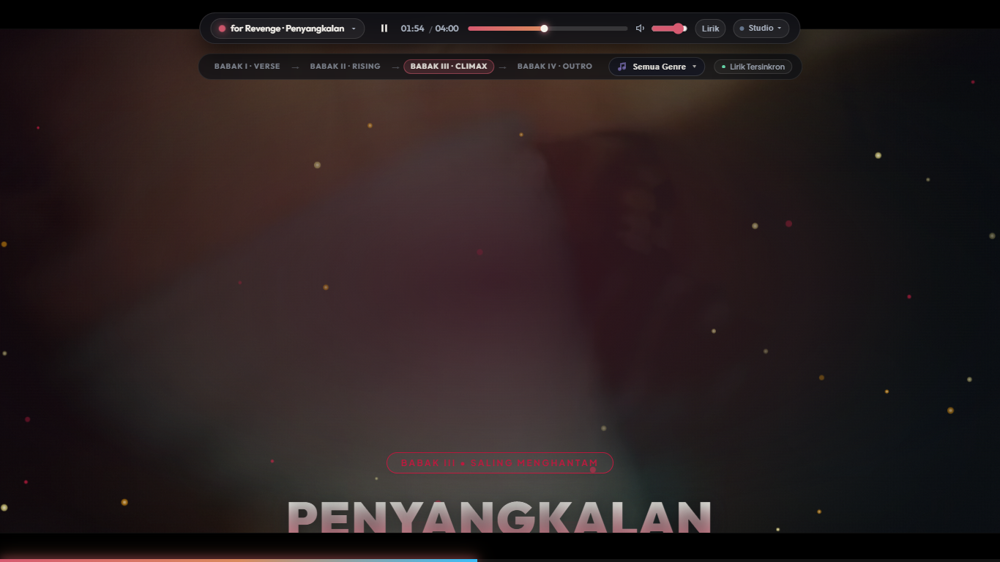
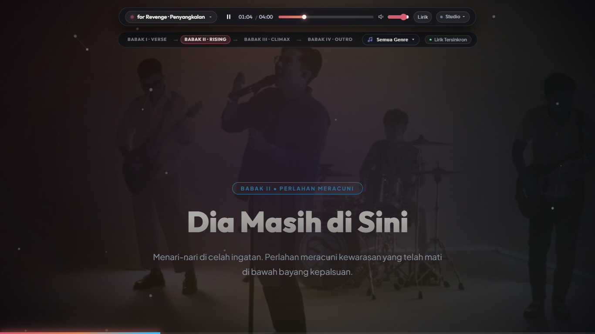
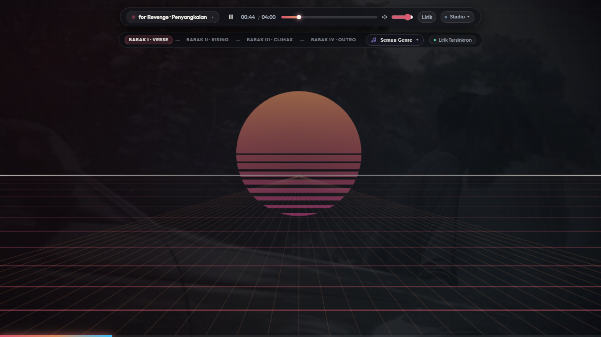

<div align="center">

# Stages of Denial (Penyangkalan)

**Pengalaman scrollytelling audiovisual yang nyaman di mata, berjalan mulus di 60-144 FPS dengan Web Audio API, panggung visual Canvas 2D adaptif, dan karaoke kinetik berpresisi 50ms.**

[](https://vitejs.dev/)
[](#struktur-direktori)
[](#2-18-pilihan-panggung-visual-2d-modular)
[](LICENSE)

</div>

---

## 📸 Preview Efek Visual

### 1. Default Clean Stage: Editorial Silk
> *Tampilan awal default yang bersih, tenang, dan elegan. Menggabungkan 3 lapis Fluid Silk Aurora, cincin orbital tipis di horizon tengah, dan partikel stardust lembut tanpa efek silau.*


<br/>

### 2. Babak III Climax: Ember Storm
> *Pusaran bara api vertikal, partikel abu beterbangan, dan pendar shockwave saat dinamika lagu mencapai puncaknya.*


<br/>

### 3. Indie Pop & Dreamy: Celestial Drift
> *Jaringan rasi bintang dinamis dengan garis penghubung antar partikel dan debu kosmik yang melayang tenang di langit malam.*


<br/>

### 4. Synth-Pop & Retro Outrun: Cyber Grid
> *Lantai perspektif 2D retro dengan matahari neon bersegmen yang berdenyut mengikuti ketukan bass dan tempo lagu.*


<br/>

### 5. Tabbed Studio HUD: 18 Pilihan Visual
> *Panel Studio modern 3 tab (Audio & Sync, Visual 2D, Ekspor & Lirik) dengan isolasi scroll mandiri dan tombol acak panggung.*


---

## Tentang Proyek Ini

Stages of Denial menggabungkan pemutaran musik, analisis frekuensi audio real-time, dan alur scrollytelling 4 babak (Verse, Rising, Climax, Outro) dalam tampilan bioskop gelap yang ramah di mata (`#0B0C10` / `#F2EFE9`).

Proyek ini siap pakai langsung setelah di-clone (Zero-Media Fallback). Jika file `.mp3` dan `.mp4` lokal tidak ada di repositori, aplikasi otomatis menyalakan synthesizer ambient bawaan dan visual Canvas 2D tanpa error. Anda juga bisa langsung memutar file MP3 dan LRC milik sendiri cukup dengan drag and drop ke browser.

---

## Fitur Utama

### 1. Panggung Default Bersih & Nyaman di Mata (Editorial Silk)
- Menjadi tampilan default saat web pertama kali dibuka: pita Fluid Silk Aurora mengalir tenang, cincin orbital tipis di tengah, stardust lembut, dan berkas cahaya halus (`opacity <= 0.08`).
- Dilengkapi tombol toggle kenyamanan membaca: `✨ Efek Reaktif Ekstra: OFF/ON` di Tab Visual untuk mematikan pendar kilat keras agar teks lirik tetap terbaca jelas.

### 2. 18 Pilihan Panggung Visual 2D Modular
Semua efek visual dibagi per modul di folder `src/visuals/scenes/`, tetap ringan di memori dan berjalan mulus di 60-144 FPS:

| Panggung Visual | Ikon | Karakter Visual & Suasana Lagu |
|:---|:---:|:---|
| **Editorial Silk** | 🌌 | *(Default)* 3 lapis pita sutra aurora lembut dan pilar cahaya tenang |
| **Kinetic Prism** | ⚡ | Garis kecepatan laser diagonal dan denyut ritmis |
| **Rain Mist** | 🌧️ | Hujan miring 2 lapisan kedalaman, kabut senja, dan riak air |
| **Ember Storm** | 🔥 | Pusaran bara api naik, kilat petir, dan shockwave klimaks |
| **Celestial Drift** | ✨ | Jaringan rasi bintang, garis relasi partikel, dan stardust |
| **Analog Wave** | 📻 | Gelombang osiloskop dual-beam fosfor dan nuansa film analog |
| **Sakura Petals** | 🌸 | Guguran kelopak sakura melayang dengan ayunan sinus |
| **Aurora Curtain** | 🌠 | Tirai aurora kutub vertikal yang bergelombang di langit malam |
| **Monolith Bars** | 🏛️ | Pilar cahaya arsitektural yang naik turun mengikuti frekuensi |
| **Liquid Horizon** | 🌊 | Ombak lautan berlapis di horizon dengan pantulan rembulan |
| **Cyber Grid** | 🌆 | Kisi lantai perspektif neon outrun dan matahari bersegmen |
| **Firefly Meadow** | 🌿 | Kunang-kunang bercahaya yang melayang di atas kabut rumput |
| **Vinyl Turntable** | 💿 | Piringan hitam berputar dengan alur refleksi cahaya |
| **Eclipse Corona** | 🌑 | Cakram gerhana bulan dengan pendar lidah api matahari |
| **Snowfall Quiet** | ❄️ | Butiran salju halus berlapis kedalaman ditiup angin tenang |
| **Prism Kaleidoscope** | 💎 | Pola simetri kristal 6 arah berdenyut mengikuti ketukan ritmis |
| **Radar Sonar** | 📡 | Pancaran sonar melingkar dan garis sapuan radar 360 derajat |
| **Golden Dust Rays** | ☀️ | Berkas cahaya matahari diagonal dan partikel debu emas |

### 3. Studio HUD 3 Tab & Isolasi Scroll Penuh
- **Navigasi 3 Tab:** `🎛️ Audio & Sync`, `🎨 Visual 2D`, dan `📤 Ekspor & Lirik`. Pilihan tab tersimpan otomatis di `localStorage`.
- **Isolasi Scroll:** Saat menggulir mouse wheel di atas panel Studio, drawer lirik, atau modal, halaman utama di belakang tidak ikut bergeser dan countdown auto-scroll tidak terganggu.
- **Tombol 🎲 Acak Panggung:** Menemukan variasi visual baru secara instan dalam satu klik.

### 4. Tap-to-Sync Studio di Browser
- Tempel teks lirik biasa, putar lagu, lalu tekan tombol `Space` tepat saat vokal masuk.
- Menyediakan tombol undo, pengatur delay langsung (`±0.05s`), serta ekspor file `.lrc` dan format `.json` karaoke 50 milidetik.

### 5. Efek Akustik Ruang DSP (5 Mode)
- Pilihan ruang audio Web Audio API: Auto-Adaptif, Studio Master, Midnight Lo-Fi, 8D Spatial, Cathedral Hall (reverb konvolusi stereo 2.4s), dan Warm Vinyl (efek piringan hitam hangat).

### 6. Subtitle Dwibahasa & Filter Genre
- Tampilan karaoke kata per kata dengan opsi terjemahan dwibahasa (Indonesia / Inggris).
- Menu pilihan genre bernuansa bioskop gelap lengkap dengan ikon dan jumlah lagu.

---

## Cara Menjalankan Proyek

**Kebutuhan:** Node.js versi 20+ dan npm.

```bash
# 1. Clone repositori
git clone https://github.com/BakwanJagungg/Stages-of-Denial.git
cd Stages-of-Denial

# 2. Pasang dependensi
npm install

# 3. Jalankan server lokal
npm run dev
```

Buka browser di `http://localhost:5173`. Perintah lain yang tersedia:

```bash
npm run build     # Buat file produksi ke folder dist/
npm run preview   # Coba jalankan hasil build secara lokal
```

---

## Memutar Lagu & Lirik Sendiri

1. **Drag and Drop Langsung (Paling Praktis)**
   - Tarik file `.mp3` (atau pasangan `.mp3` + `.lrc`) dari komputer Anda dan lepas langsung ke jendela browser untuk memutarnya.
2. **Menu Jukebox**
   - Tekan tombol `L` di keyboard untuk membuka koleksi lagu atau klik tombol **Unggah MP3**.
3. **Penyimpanan Manual**
   - Taruh file audio di `public/assets/audio/<track-id>.mp3` dan video loop di `public/assets/video/<track-id>.mp4`. Jika file tidak ada, suara ambient sintetis otomatis aktif tanpa error.

---

## Struktur Direktori

```text
├── config/
│   ├── tracks.json               # Daftar 14 lagu kurasi utama dan tema visual
│   ├── timeline.json             # Struktur narasi 4 babak
│   └── playlist_catalog.json     # Metadata katalog playlist
├── css/
│   └── style.css                 # Desain antarmuka bioskop dan tata letak responsif
├── docs/
│   └── screenshots/              # Gambar dokumentasi efek visual
├── public/assets/
│   ├── audio/                    # Tempat file .mp3 lokal (opsional, gitignored)
│   ├── covers/                   # Gambar cover 14 lagu kurasi
│   ├── lyrics/                   # File lirik karaoke presisi 50ms (.json)
│   └── video/                    # Video loop latar belakang (gitignored)
├── src/
│   ├── audio/                    # Pengolah DSP Web Audio, clock, dan synth ambient
│   ├── lyrics/                   # Mesin karaoke kinetik dan Tap-to-Sync Studio
│   ├── scroll/                   # Pengatur scroll 4 babak dan isolasi popover
│   ├── ui/                       # Modal Jukebox, filter genre, dan Studio HUD 3 tab
│   ├── visuals/scenes/           # 18 modul panggung visual 2D
│   ├── visuals/canvasVisualizer.js # Kanvas visual 2D utama dan efek film grain
│   └── main.js                   # Inisialisasi aplikasi dan pengatur state utama
├── index.html
├── package.json
└── vite.config.js
```

---

## Pintasan Keyboard

| Tombol | Fungsi |
|:---|:---|
| `Space` | Putar / Jeda Audio |
| `←` / `→` | Mundur / Maju 5 detik |
| `↑` / `↓` | Volume Master ±10% |
| `M` | Matikan / Nyalakan Suara (Mute) |
| `L` | Buka / Tutup Jukebox |
| `T` | Buka / Tutup Drawer Lirik & Live Sync |
| `D` | Buka / Tutup Panel Studio HUD |
| `[` / `]` / `\` | Set Titik A / Set Titik B / Hapus A-B Loop |
| `Q` | Ekspor Gambar Kartu Kutipan Lirik PNG (1080x1920) |
| `F` | Layar Penuh (Fullscreen) |
| `Esc` | Tutup modal atau drawer yang sedang aktif |

---

## Lisensi

Proyek ini dirilis di bawah [Lisensi MIT](LICENSE).
