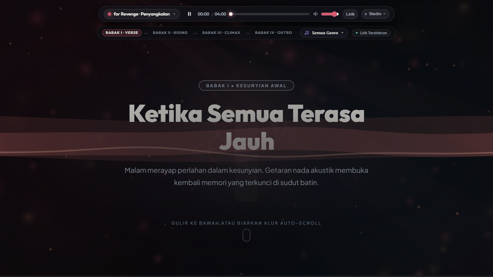
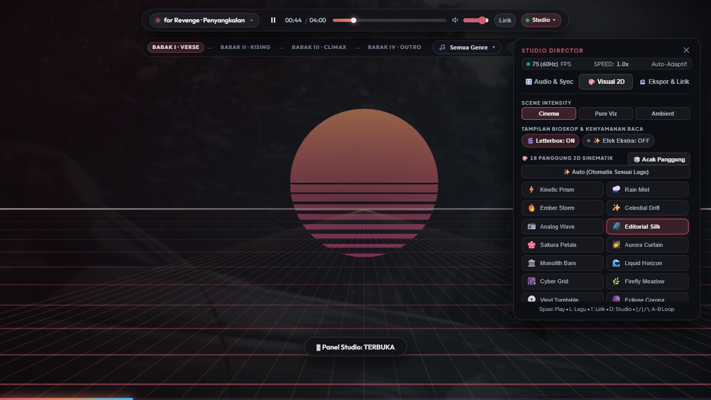

<div align="center">

# Stages of Denial (Penyangkalan)

**An eye-comfort 60–144 FPS audiovisual scrollytelling experience powered by Web Audio API DSP, adaptive Canvas 2D cinematic scenes, and 50ms precision kinetic karaoke.**

[](https://vitejs.dev/)
[](#architecture)
[](#18-optional-2d-cinematic-scene-archetypes)
[](LICENSE)

</div>

---

## 📸 Preview Efek Visual

### 1. Default Clean Stage: Editorial Silk
> *Tampilan awal default yang bersih, tenang, dan elegan. Menggabungkan 3 lapis Fluid Silk Aurora, cincin orbital tipis di horizon tengah, dan pendar lembut stardust tanpa silau.*


<br/>

### 2. Babak III Climax: Ember Storm
> *Pusaran bara api vertikal yang bergejolak, partikel abu terbang, dan kilatan shockwave amarah saat dinamika audio mencapai puncaknya.*


<br/>

### 3. Indie Pop & Dreamy: Celestial Drift
> *Jaringan rasi bintang dinamis dengan garis penghubung kedekatan partikel dan debu kosmik mengapung bebas di langit malam.*


<br/>

### 4. Synth-Pop & Retro Outrun: Cyber Grid
> *Kisi perspektif lantai 2D retro dengan matahari terbenam neon bersegmen yang berdenyut mengikuti denyut bass dan tempo.*


<br/>

### 5. Tabbed Studio HUD (Varian 18 Panggung 2D)
> *Panel kontrol studio 3-tab modern (Audio & Sync · Visual 2D · Ekspor & Lirik) dengan isolasi scroll penuh dan tombol acak panggung.*


---

## Overview

**Stages of Denial** memadukan sinkronisasi pemutaran musik, analisis spektrum Web Audio real-time, dan koreografi 4 babak scrollytelling (*Verse → Rising → Climax → Outro*) ke dalam antarmuka sinematik ramah mata berlatar gelap (`#0B0C10` / `#F2EFE9`).

Proyek ini dirancang **100% mandiri (Zero-Media Fallback)**: jika file `.mp3` dan `.mp4` lokal tidak disertakan di repositori publik, aplikasi langsung mengaktifkan **Generative Ambient Pad Synth** dan **Canvas 2D Pure Silk Renderer** secara otomatis, serta mendukung fitur Drag & Drop instan untuk file MP3 dan LRC milik pengguna.

---

## Fitur Utama (v16.0)

### 1. Default Clean & Eye-Comfort Stage (`editorial-silk`)
- Menjadi tampilan default awal saat pertama kali membuka website: pita *Fluid Silk Aurora* mengalir halus dengan opasitas lembut, cincin orbital tipis elegan di tengah, partikel bokeh/stardust tenang, serta *god-rays* halus (`opacity <= 0.08`).
- Dilengkapi toggle kenyamanan baca: **`✨ Efek Reaktif Ekstra: OFF/ON`** di Tab Visual untuk meredam beat flash keras sehingga lirik karaoke tetap sangat nyaman dibaca.

### 2. 18 Arketipe Panggung 2D Sinematik Modular
Seluruh adegan 2D diarsiteksikan secara modular di `src/visuals/scenes/` dengan alokasi heap nol (*zero-allocation per frame*) pada 60–144 FPS:

| Arketipe Panggung | Ikon | Karakter Visual & Mood Lagu |
|:---|:---:|:---|
| **Editorial Silk** | 🌌 | *(Default)* 3 lapis pita sutra aurora cair + pilar cahaya lembut |
| **Kinetic Prism** | ⚡ | Laser speed streaks diagonal + denyut geometri ritmis |
| **Rain Mist** | 🌧️ | Hujan miring 2 kedalaman + kabut senja + ripple air |
| **Ember Storm** | 🔥 | Pusaran bara api naik + kilat petir + shockwave amarah |
| **Celestial Drift** | ✨ | Jaringan konstelasi bintang + tautan kedekatan + stardust |
| **Analog Wave** | 📻 | Gelombang osiloskop dual-beam fosfor + halasi film analog |
| **Sakura Petals** | 🌸 | Guguran kelopak sakura melayang dengan goyangan sinus |
| **Aurora Curtain** | 🌠 | Tirai vertikal aurora kutub berombak di langit malam |
| **Monolith Bars** | 🏛️ | Pilar monolit cahaya arsitektural mengikuti spektrum |
| **Liquid Horizon** | 🌊 | Ombak samudra berlapis di horizon + pantulan rembulan |
| **Cyber Grid** | 🌆 | Lantai perspektif outrun neon + matahari terbenam bersegmen |
| **Firefly Meadow** | 🌿 | Kunang-kunang bioluminesen melayang organik di kabut padang |
| **Vinyl Turntable** | 💿 | Piringan hitam berputar sinematik dengan alur refleksi cahaya |
| **Eclipse Corona** | 🌑 | Cakram gerhana bulan dengan korona surya berdenyut |
| **Snowfall Quiet** | ❄️ | Butiran salju halus multi-kedalaman melayang ditiup angin |
| **Prism Kaleidoscope** | 💎 | Simetri radial 6 arah berdenyut mengikuti ketukan ritmis |
| **Radar Sonar** | 📡 | Pancaran sonar konsentris + garis sapuan radar 360° |
| **Golden Dust Rays** | ☀️ | Berkas cahaya matahari diagonal + debu emas melayang tenang |

### 3. Redesain Tabbed Studio HUD & Scroll-Lock Isolation
- **Sistem 3 Tab Rapi:** `🎛️ Audio & Sync`, `🎨 Visual 2D`, dan `📤 Ekspor & Lirik` dengan status tab yang tersimpan otomatis di `localStorage`.
- **Scroll-Lock Isolation:** Interaksi gulir mouse wheel pada `#studioPopover`, `#lyricDrawer`, `#jukeboxOverlay`, maupun modal lirik terisolasi secara internal (`overscroll-behavior: contain` + `data-lenis-prevent`) tanpa menggeser halaman latar belakang dan tanpa memicu countdown pill auto-scroll.
- **Tombol 🎲 Acak Panggung:** Menemukan variasi visual baru hanya dengan satu klik instan.

### 4. In-Browser Tap-to-Sync Lyric Studio
- Tempel lirik teks biasa, putar lagu, dan ketuk tombol `Space` secara langsung sesuai ketukan vokal.
- Dilengkapi fitur *Undo*, preview live offset (`±0.05s`), serta ekspor file `.lrc` dan format `.json` karaoke berpresisi 50 milidetik.

### 5. Virtual Acoustic Room DSP (5 Mode)
- Pilihan profil akustik imersif: *Auto-Adaptif*, *Studio Master*, *Midnight Lo-Fi*, *8D Spatial*, *Cathedral Hall* (`ConvolverNode` stereo 2.4s), dan *Warm Vinyl* (simulasi desis hangat pita analog).

### 6. Dual-Language Subtitles & Select2 Genre Filter
- Penanda karaoke suku kata kinetik dengan terjemahan dwibahasa (Indonesia / Inggris).
- Dropdown genre kustom bertema bioskop gelap dengan ikon dinamis dan penghitung lagu otomatis.

---

## Menjalankan Proyek

**Kebutuhan:** Node.js versi `20+` dan `npm`.

```bash
# 1. Clone repositori
git clone https://github.com/BakwanJagungg/Stages-of-Denial.git
cd Stages-of-Denial

# 2. Pasang dependensi
npm install

# 3. Jalankan server pengembangan
npm run dev
```

Buka peramban di `http://localhost:5173`. Perintah tambahan yang tersedia:

```bash
npm run build     # Kompilasi paket produksi teroptimasi ke dist/
npm run preview   # Pratinjau lokal dari paket produksi dist/
```

---

## Memutar Audio & Lirik Pribadi

1. **Fitur Drag & Drop Instan (Disarankan)**
   - Tarik dan lepas file `.mp3` (atau pasangan `.mp3` + `.lrc`) langsung ke jendela browser untuk memulai pemutaran tersinkronisasi seketika.
2. **Pustaka Jukebox Antologi**
   - Tekan tombol `L` pada keyboard untuk membuka Jukebox, memilih lagu kurasi, atau mengeklik **Unggah MP3**.
3. **Penyimpanan Aset Lokal**
   - Letakkan file audio di `public/assets/audio/<track-id>.mp3` dan video latar di `public/assets/video/<track-id>.mp4`. Jika media belum tersedia, mode *Generative Ambient Pad* akan aktif otomatis tanpa galat.

---

## Struktur Direktori

```text
├── config/
│   ├── tracks.json               # 14 lagu kurasi utama & tema visual
│   ├── timeline.json             # Struktur narasi 4 babak
│   └── playlist_catalog.json     # Metadata katalog antologi
├── css/
│   └── style.css                 # Palet bioskop rendah silau & tata letak responsif
├── docs/
│   └── screenshots/              # Dokumentasi tangkapan layar visual
├── public/assets/
│   ├── audio/                    # File .mp3 lokal (opsional, gitignored)
│   ├── covers/                   # Cover art 14 lagu kurasi
│   ├── lyrics/                   # Jadwal karaoke presisi 50ms (.json)
│   └── video/                    # Video loop latar belakang (gitignored)
├── src/
│   ├── audio/                    # DSP Web Audio, clock sinkronisasi, ambient synth
│   ├── lyrics/                   # Mesin karaoke kinetik & Tap-to-Sync Studio
│   ├── scroll/                   # Lenis + GSAP koreografi 4 babak & isolasi scroll
│   ├── ui/                       # Jukebox modal, filter genre, Studio HUD tabbed
│   ├── visuals/scenes/           # 18 modul arketipe panggung 2D zero-allocation
│   ├── visuals/canvasVisualizer.js # Kompositor kanvas 2D utama & film grain 35mm
│   └── main.js                   # Bootstrap aplikasi & orkestrator state
├── index.html
├── package.json
└── vite.config.js
```

---

## Pintasan Keyboard

| Tombol | Fungsi |
|:---|:---|
| `Space` | Putar / Jeda Audio |
| `←` / `→` | Mundur / Maju 5 detik |
| `↑` / `↓` | Atur Volume Master ±10% |
| `M` | Matikan / Nyalakan Suara (Mute) |
| `L` | Buka / Tutup Jukebox Antologi |
| `T` | Buka / Tutup Drawer Lirik & Live Sync |
| `D` | Buka / Tutup Studio HUD (Tabbed Popover) |
| `[` / `]` / `\` | Pasang Titik A / Pasang Titik B / Hapus A-B Loop |
| `Q` | Ekspor Kartu Kutipan Lirik PNG (`1080×1920`) |
| `F` | Mode Bioskop Layar Penuh (Fullscreen) |
| `Esc` | Tutup modal/drawer aktif atau keluar mode bioskop |

---

## Lisensi

Dilisensikan di bawah [Lisensi MIT](LICENSE).
